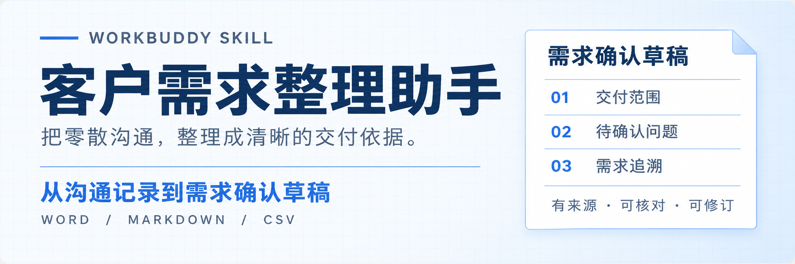
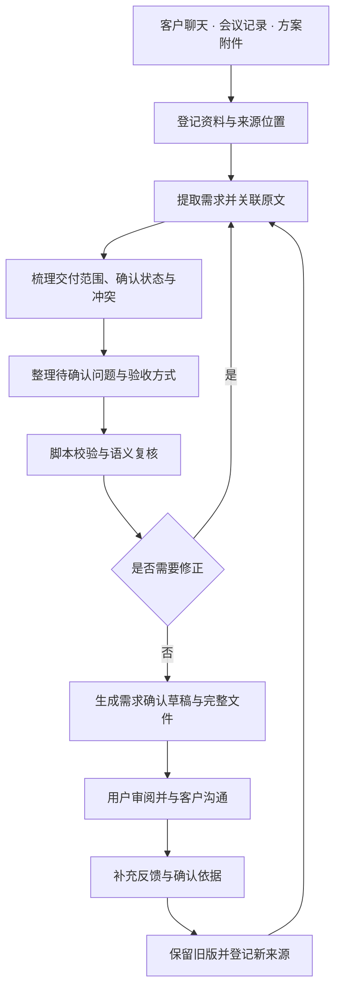

<p align="center">
  
</p>

<h1 align="center">客户需求整理助手</h1>
<p align="center"><strong>让每一项客户需求，都有依据、有边界、有明确的下一步。</strong></p>
<p align="center">Customer Requirements Assistant<br>面向多种 Agent 客户端的跨行业需求整理 Skill</p>
<p align="center">
  <a href="LICENSE"></a>
  
  <a href="https://raw.githubusercontent.com/zcjunblog/customer-requirements-assistant/main/releases/0.2.1/customer-requirements-assistant-0.2.1.zip"></a>
  
</p>
<p align="center">
  <a href="#核心能力">核心能力</a> ·
  <a href="#工作流程">工作流程</a> ·
  <a href="#实际案例">实际案例</a> ·
  <a href="#快速开始">快速开始</a> ·
  <a href="#客户端与验证范围">客户端支持</a> ·
  <a href="#参与贡献与许可证">参与贡献</a>
</p>

客户需求往往分散在聊天记录、会议纪要和方案附件里。交付内容需要反复核对，日期与数量可能前后变化，讨论中的建议也容易被误写成已经确定的安排。

**客户需求整理助手将这些沟通材料组织成有来源依据的需求确认草稿，梳理交付范围、待确认问题与验收方式，并生成可编辑、可追溯、可持续修订的文件。**

你提供资料和业务背景，AI 负责提取、整理与检查；需要客户决定的事项清楚保留，后续反馈继续进入版本记录。从首次沟通到需求修订，始终能够回答三个问题：**要交付什么、依据是什么、还有什么需要确认。**

## 核心能力

| 业务中的常见问题 | 助手提供的支持 |
| --- | --- |
| 要求散落在多份材料中，整理耗时 | 汇总聊天文本、会议记录与文档，按目标、交付物、时间、预算线索、责任和限制组织需求。 |
| 同一个要求出现多个版本 | 并列保留日期、人数、范围等差异及其来源，列出需要确认的变更。 |
| 客户要求、内部建议与推断混在一起 | 分别标注依据类型和客户确认状态，让建议与待定事项保持清晰。 |
| 交付范围明确了，验收方式还不清楚 | 整理原有验收要求；缺少约定时提出带有“建议”标记的验收方式。 |
| 初稿之后仍有大量问题需要追问 | 优先列出影响交付的 3～5 个问题，同时保留完整问题清单。 |
| 文档结论难以追溯 | 为需求保留稳定编号、原文引文与实际资料位置，生成内部追溯表。 |
| 客户补充意见后，旧版与新版难以核对 | 保留原始来源和旧版数据，记录新增、修改与移除事项，每次输出独立版本。 |

## 适用场景

面向客户经理、项目负责人、设计与制作服务商、活动团队、培训咨询机构和软件服务团队。使用统一的需求结构，按业务场景调整表达。

| 场景 | 整理重点 |
| --- | --- |
| 品牌设计与内容制作 | 使用渠道、尺寸数量、文件格式、素材责任、修改轮次与交付节点 |
| 活动策划与执行 | 活动日期、人数、场地条件、物料、人员分工与现场交接 |
| 企业培训与咨询 | 培训对象、课程目标、时长、预算、讲义、可选服务与反馈方式 |
| 软件与网站项目 | 用户角色、业务流程、功能范围、资料依赖、交付方式与验收场景 |
| 其他项目服务 | 目标、交付物、期限、责任、限制条件与待确认事项 |

## 工作流程

从资料到交付，按七个阶段推进。已有材料足以形成初稿时先完成整理，缺口进入问题清单；用户补充反馈后，再继续修订。

| 阶段 | 处理内容 | 可以查看的结果 |
| --- | --- | --- |
| **01 · 资料接入** | 登记文件，提取可读文本，建立来源编号与位置；记录读取失败和覆盖限制。 | 来源快照、资料清单与读取提示 |
| **02 · 需求提取** | 结合行业语境提取目标、对象、交付物、数量、时间、预算线索和配合要求。 | 结构化需求记录与原文依据 |
| **03 · 范围与状态梳理** | 区分明确表述、推断和建议；单独核对客户确认依据，保留前后冲突。 | 交付范围、确认状态与冲突清单 |
| **04 · 问题与验收整理** | 汇总缺失信息，优先安排影响交付的问题；区分原文验收要求与建议验收方式。 | 待确认问题与验收条目 |
| **05 · 校验与复核** | 脚本检查结构、引用、数字和状态一致性；AI 核对说话人、语气、条件与语义。 | 校验报告及修正后的需求数据 |
| **06 · 文档交付** | 生成需求确认草稿、问题清单、追溯表及可用的 Word，检查内容与文件。 | 独立版本目录和交付清单 |
| **07 · 反馈与修订** | 将补充沟通登记为新来源，沿用需求编号，对照旧版记录变化。 | 新版文件、变更说明与上一版数据 |



**“资料明确提出”和“客户已经确认”分别记录。** 普通提问、初步设想、内部建议及催促发稿均不能替代客户确认依据。生成的文件保留草稿标识，供进一步核对与沟通。

## 实际案例

以下为 WorkBuddy 客户端实测使用的**虚构培训场景**：

> 客户提出为 30 名新员工安排半天培训，预算 8000 元，日期为 11 月 20 日，需要提供讲义。随后补充：人数可能调整为 50 人，名单尚未确定。销售建议增加录播和课后答疑；内部项目经理希望先按 50 人、包含录播和 11 月 21 日写入文档。

整理后，关键事项保留如下：

| 事项 | 文档中的处理 |
| --- | --- |
| 培训人数 | 保留原始 30 人与可能调整为 50 人的来源，最终人数待确认。 |
| 时长与预算 | 保留“半天”和“8000 元”，预算包含哪些交付内容列入问题。 |
| 培训日期 | 同时记录 11 月 20 日与内部提出的 11 月 21 日，提示日期差异。 |
| 讲义 | 保留客户已提出的交付要求，形式、份数与交付时间待确认。 |
| 录播与答疑 | 标记为建议增项，未纳入客户承诺。 |

v0.2.1 客户端案例形成 **8 条需求、2 个冲突、6 个集中问题**，生成 Word、Markdown 及内部追溯文件；8 条需求均保留待确认状态。

[查看实际需求确认草稿](evidence/0.2.1/workbuddy-smoke/需求确认书.md) · [查看待确认问题](evidence/0.2.1/workbuddy-smoke/待确认问题.md) · [查看验证记录](evidence/0.2.1/verification.md)

该案例用于展示整理方式与真实文件产出。面向客户交付前，仍应审阅标题、内部意见措辞和敏感信息。

## 快速开始

### 1. 选择客户端并安装

技能主体遵循 [Agent Skills 标准](https://agentskills.io/specification)，业务流程与脚本不依赖特定模型或客户端。提供两种安装包：

- [**通用 Skill 包 · v0.2.1**](https://raw.githubusercontent.com/zcjunblog/customer-requirements-assistant/main/releases/0.2.1/customer-requirements-assistant-0.2.1.zip)：用于支持标准技能目录的客户端，或由其他Agent显式读取执行。
- [**WorkBuddy 导入包 · v0.2.1**](https://raw.githubusercontent.com/zcjunblog/customer-requirements-assistant/main/releases/0.2.1/customer-requirements-assistant-workbuddy-0.2.1.zip)：包含WorkBuddy展示元数据，在客户端技能页面上传。

从源码安装，以 Codex 项目目录为例：

```sh
git clone https://github.com/zcjunblog/customer-requirements-assistant.git
cd customer-requirements-assistant
python3 tools/install.py --client codex --project /path/to/your-project --dry-run
python3 tools/install.py --client codex --project /path/to/your-project
```

`/path/to/your-project`替换为实际项目路径。安装器只复制技能文件，不安装依赖、不更改账号或全局规则；已有同名安装时默认停止，显式`--replace`会先备份。

将`codex`替换为`claude`、`cursor`、`copilot`、`gemini`或`opencode`即可使用对应目录；用户级安装加`--scope user`并去掉`--project`。也支持`--dest /path/to/skills`自定义目录和`--dry-run`预览。安装后重新加载或新建会话，再选择技能。

完整文件处理需要宿主提供文件读取、Python执行和任务目录写入能力；不具备执行能力时可使用Markdown整理模式。[查看各客户端安装路径、手动加载方法与验证状态](docs/compatibility.md)

### 2. 检查运行环境

基础文本整理和 Markdown / CSV 输出只需 Python 3.9+。需要 Word 导出或读取文本 PDF 时，在仓库目录准备独立环境：

```sh
python3 -m venv .venv
.venv/bin/python -m pip install -r skills/customer-requirements-assistant/requirements-optional.txt
.venv/bin/python skills/customer-requirements-assistant/scripts/requirements_tool.py doctor
```

让 Agent 使用检测通过的解释器运行技能。Windows 的虚拟环境解释器为`.venv\Scripts\python.exe`；其他路径以实际安装位置为准。Word 不可用时仍可生成 Markdown 与追溯表，报告会说明缺失的格式。

### 3. 提供资料并开始整理

新建任务，粘贴沟通文本或提供文件，然后说明目标：

```text
使用客户需求整理助手，把这些客户聊天和会议记录整理成需求确认书。
请明确交付范围、时间安排、待确认问题和验收方式，生成 Word 和需求追溯表。
资料没有说明的地方保留待确认。
```

也可以直接描述当前问题：

```text
对照这份方案和会议记录，找出交付范围、人数和日期上的冲突，
整理出需要与客户集中确认的问题。
```

### 4. 根据反馈持续修订

提供上一版需求数据、来源数据和补充沟通，继续说明：

```text
客户补充了新的意见，请修订上一版需求确认书。
保留原有需求编号和来源，列出新增、修改与移除事项，不覆盖旧版文件。
```

## 交付内容

每次执行创建独立目录，便于审阅、归档和版本比较。

| 文件 | 用途 |
| --- | --- |
| **需求确认书.md / .docx** | 汇总需求、交付范围、确认状态、验收方式和待确认事项；Word 在依赖可用时生成。 |
| **待确认问题.md** | 集中安排沟通，说明问题影响与建议确认对象。 |
| **需求追溯表.csv** | 按需求编号核对内容、状态、原文依据、依赖与验收条目。 |
| **来源索引.md** | 查看资料位置、原文摘录与读取覆盖情况。 |
| **版本变化.md** | 查看本次修订涉及的变化及说明。 |
| **需求数据.json / 来源数据.json** | 保存结构化记录，支持后续校验和修订。 |
| **校验报告.json / 交付清单.json** | 查看检查结果、Word 生成状态及文件摘要。 |
| **上一版需求数据.json** | 修订时保留，用于核对历史内容。 |

需求确认书经审阅后可用于客户沟通。追溯表、来源索引和 JSON 含完整原文，作为内部工作资料保存。

## 输入与运行环境

| 输入类型 | 当前支持范围 |
| --- | --- |
| 粘贴文本、TXT、Markdown | 支持；保留文本位置与原文。 |
| DOCX | 支持正文段落和表格；图片、批注、页眉页脚等不在提取范围内。 |
| 有文本层的 PDF | 通过可选依赖 `pypdf` 提取，标记无法提取文本的页面。 |
| 图片、扫描件、录音、旧版 DOC | 首版脚本不支持，可先转换为可读文本。 |

核心脚本需要 **Python 3.9+**，使用标准库完成基础读取、校验和 Markdown / CSV 输出。Word 导出使用 `python-docx`，PDF 读取使用 `pypdf`。优先使用宿主已有环境；缺少可选依赖时，报告限制并交付可用格式。

[运行与故障处理](skills/customer-requirements-assistant/references/runtime.md) · [数据结构说明](skills/customer-requirements-assistant/references/schema.md) · [行业参考](skills/customer-requirements-assistant/references/industries.md)

<details>
<summary>处理规模与使用边界</summary>

- 单文件不超过 5 MiB，每批最多 20 个输入文件，累计最多 40 个来源、50 万字符；模型上下文不足时仍需分批阅读。
- 包内脚本不发起网络请求，无需额外模型 API 密钥。需求理解由当前 Agent 模型完成，资料处理遵循宿主服务规则。
- 校验器检查结构、精确引文、阿拉伯数字和状态一致性。说话人身份、否定条件、中文数词与语义是否准确，需要 AI 及人工复核。
- 默认处理用户提供或授权的材料，不读取聊天账号、不发送消息、不自动报价或代替客户确认。
- Word 跨设备打开时可能发生字体替换，交付前应检查实际版式。行业专业规范和既有承诺应以可核对的资料为准。

</details>

## 客户端与验证范围

| 接入方式 | 当前记录 |
| --- | --- |
| WorkBuddy | 已完成导入与虚构资料实际任务；v0.2.1最终包经平台解析，见[本版报告](evidence/0.2.1/verification.md) |
| Codex | v0.2.0本机CLI完成技能发现与实际任务；v0.2.1完整脚本与分发回归通过 |
| Claude Code、Cursor、Copilot、Gemini CLI、OpenCode | 提供目录安装与资源适配，尚未逐一完成真实客户端任务 |
| 其他Agent | 可显式读取SKILL.md；根据宿主文件、Python和文档能力确定可用范围 |

安装目录、技能发现和实际任务分别验证。各系统、客户端版本和复杂业务材料的效果需按实际环境复核；详见[兼容说明](docs/compatibility.md)。

## 开发与验证

需求理解、结构化校验和文件生成分别承担明确职责：Agent 模型负责理解业务材料，数据协议保存需求与证据，Python 工具完成读取、检查和导出。

```text
customer-requirements-assistant/
├── skills/customer-requirements-assistant/
│   ├── SKILL.md           技能入口与执行流程
│   ├── scripts/           资料读取、校验与文档生成
│   ├── references/        数据协议、行业提示与运行指南
│   └── templates/         数据模板与虚构培训示例
├── tests/                 自动测试与四行业固定样例
├── distribution/          WorkBuddy专用展示元数据
├── tools/                 多客户端安装、双包构建与验证工具
├── evidence/              虚构案例及验证记录
├── releases/              独立安装包、文件清单与校验摘要
└── memory-bank/           产品设计、实施计划与开发待办
```

运行测试与构建：

```sh
.venv/bin/python -m unittest discover -s tests -v
.venv/bin/python tools/build_release.py --out outputs/release-preview
.venv/bin/python tools/smoke_archive.py
```

v0.2.1优化了Word与Markdown的标题、首页概览、正文层级和分页；四行业固定样例验证读取、校验与导出流程，客户端案例另行检查。工程测试、版式检查和真实任务的范围见[本版验证报告](evidence/0.2.1/verification.md)。脚本校验通过仍需复核语义、客户确认依据和对外措辞。

## 路线图

当前版本聚焦**跨客户端使用、资料整理、需求追溯、状态区分和文件交付**。后续计划围绕实际使用反馈完善：

- 客户文档措辞、标题和版式优化。
- 用户自有需求模板映射。
- 图片聊天记录与扫描件支持。
- 更多行业案例、复杂文档及跨平台验证。

## 参与贡献与许可证

项目已开源，采用 [MIT 许可证](LICENSE)，可在遵守许可证的前提下使用、修改和分发。欢迎提交需求整理案例、字段与模板建议、文档改进和问题修复；具体流程见[贡献指南](CONTRIBUTING.md)。

提交反馈时请使用虚构或充分脱敏的材料，注明版本、运行环境、复现步骤和预期结果。真实客户原文、内部追溯资料、账号信息及密钥不进入公开 Issue 或 PR。

[提交问题或建议](https://github.com/zcjunblog/customer-requirements-assistant/issues) · [查看源码](https://github.com/zcjunblog/customer-requirements-assistant)

GitHub开源独立于市场审核；WorkBuddy历史提审与后续状态以[平台记录](docs/marketplace/submission.md)为准。

[版本记录](CHANGELOG.md) · [产品设计](memory-bank/design.md) · [开发待办](memory-bank/todo.md) · [安装包校验摘要](releases/0.2.1/SHA256SUMS)

<p align="center">Created by <a href="https://github.com/zcjunblog">zcjunblog</a> · <a href="https://github.com/zcjunblog/sitecraft">Sitecraft 官网设计 Skill</a></p>
